 

<h2>⚡ TECH ARSENAL</h2>

  

<h2>📊 STATS</h2>

<h2>🐍 CONTRIBUTION SNAKE</h2>

<h2>🤝 LET'S CONNECT</h2>

<!-- Uncomment and edit:

-->

  
<i>"First, solve the problem. Then, write the code."</i>

