<!--
  Nima Kheradi - profile README
  Everything visual lives in /assets and is generated by generate.py
  (edit the CONFIG block at the top of that file, run `python generate.py`, commit).

  To make a project card clickable, wrap its  like this:
  

  Keep the block below free of blank lines, otherwise GitHub wraps the images in
  paragraphs and the spacing between them changes.
-->

 

 

