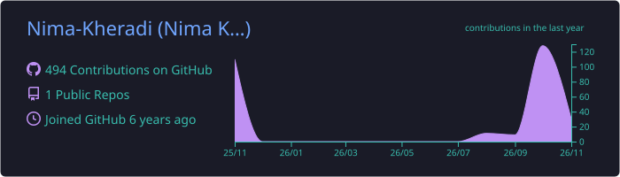
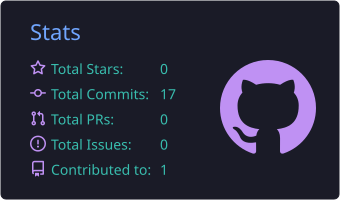
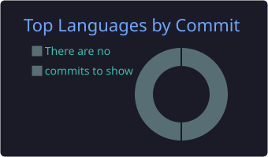
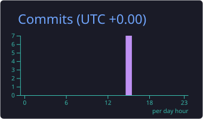

<!-- ============ HEADER ============ -->
<div align="center">


<a href="https://github.com/Nima-Kheradi">
  
</a>

<br/>


<a href="https://github.com/Nima-Kheradi?tab=followers"></a>
<a href="https://nimakheradi.ir"></a>

</div>

<br/>

---

## 👨‍💻 About me

```js
const nima = {
  name: "Nima Kheradi",
  role: "Programmer",
  location: "Tehran, Iran 🇮🇷",
  focus: ["Web development", "Clean & fast UIs", "Backend logic"],
  currentlyLearning: ["TypeScript", "System design", "Open source"],
  funFact: "I break things on purpose to learn how they work.",
  lookingFor: "Cool projects & people to build with",
};
```

- 🌐 Building modern, fast and clean **web applications**
- 🧠 Always learning — one bug at a time
- 🤝 Open to collaboration, ideas and good coffee ☕
- 📫 Reach me through my website: **[nimakheradi.ir](https://nimakheradi.ir)**

---

## 🛠️ Tech Stack & Tools

<div align="center">


<br/><br/>

<sub>🗄️ Databases & DevOps</sub>


</div>

---

## 📊 GitHub Stats

<div align="center">







</div>

---

## 🐍 Contribution Snake

<div align="center">


</div>

---

## 📌 Featured Projects

<div align="center">

<a href="https://github.com/Nima-Kheradi/Nima._.Khe"><b>Nima._.Khe</b></a> — my personal repository 🚀

</div>

---

## 🤝 Let's Connect

<div align="center">

<a href="https://nimakheradi.ir"></a>
<a href="https://github.com/Nima-Kheradi"></a>
<!-- Uncomment and edit the ones you use:
<a href="https://t.me/YOUR_ID"></a>
<a href="https://instagram.com/YOUR_ID"></a>
<a href="mailto:YOUR_EMAIL"></a>
<a href="https://linkedin.com/in/YOUR_ID"></a>
-->

<br/><br/>

<i>"First, solve the problem. Then, write the code."</i>


</div>
